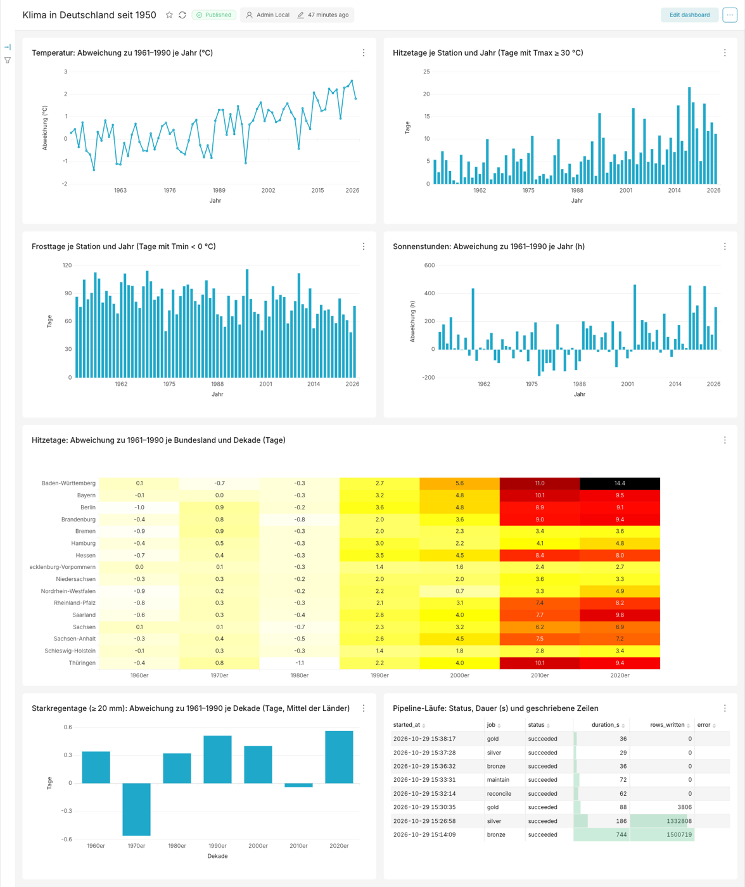
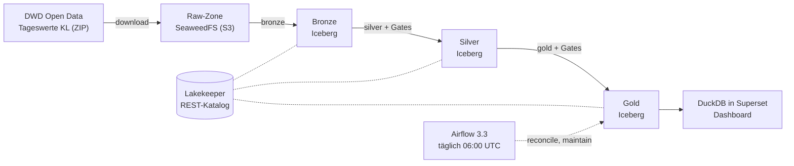

# Climate Lakehouse – Deutschlands Klima seit 1950

[](https://github.com/riodeb21195/climate-lakehouse/actions/workflows/ci.yml)
[](https://github.com/riodeb21195/climate-lakehouse/actions/workflows/cd.yml)

Eine lokale Lakehouse-Pipeline (Bronze/Silver/Gold auf Apache Iceberg) über Tageswerte des DWD.
**Leitfrage:** Wie haben sich Hitzetage, Frosttage, Starkregentage, Sonnenstunden und
Mitteltemperatur in Deutschland seit 1950 verändert, je Bundesland und Jahrzehnt, verglichen mit
der Referenzperiode 1961–1990?



## Ergebnis (50 Stationen, alle 16 Bundesländer)

Mittel der 16 Bundesländer, Abweichung zum Stationsmittel 1961–1990 (`gold.state_decade`):

| Dekade | Mitteltemperatur | Hitzetage (≥ 30 °C) | Frosttage (< 0 °C) | Starkregentage (≥ 20 mm) | Sonnenstunden |
|---|---|---|---|---|---|
| 1960er | −0,23 °C | −0,4 | +5,1 | +0,33 | +3 h |
| 1990er | +0,67 °C | +2,4 | −8,8 | +0,51 | +81 h |
| 2010er | +1,26 °C | +6,6 | −9,6 | −0,04 | +134 h |
| 2020er (2020–2025) | +2,01 °C | +7,2 | −21,6 | +0,56 | +255 h |

- Die 2020er sind rund 2 °C wärmer als 1961–1990, mit gut 7 Hitzetagen mehr und gut 20 Frosttagen weniger pro Station und Jahr. Bei Starkregen zeigt die Stichprobe keinen klaren Trend.
- Lauf von null: 1.500.719 Rohzeilen, 9 davon von den Regeln abgelehnt (0,0007 %). Läuft auf einem 2-Kern-Laptop mit 8 GB RAM.
- Ein Wiederholungslauf lädt 0 Archive und schreibt 0 Zeilen neu (101 Dateien übersprungen).

## Architektur



Airflow startet täglich download → bronze → silver → gold → reconcile → maintain. Spark schreibt
alle Schichten über den Lakekeeper-Katalog, DuckDB liest Gold für das Dashboard. Jeder Job
protokolliert Lauf und Prüfungen in `ops.pipeline_runs` und `ops.quality_results`.

**Tech-Stack:** Python 3.12, PySpark 4.1, Apache Iceberg 1.12, Lakekeeper, SeaweedFS (S3), Airflow 3.3, DuckDB, Superset, Docker Compose, GitHub Actions, uv, ruff, mypy, pytest

## Highlights

- **Inkrementell und idempotent:** Dateiversionen per SHA-256, Iceberg-`MERGE` nur für geänderte Stationen, Gold überschreibt nur geänderte Dekaden. Eine ältere Dateiversion überschreibt nie einen neueren Stand.
- **Datenqualität ohne Framework:** eigene PySpark-Regeln und Gates. Abgelehnte Zeilen landen mit Regelnamen in einer eigenen Tabelle, `reconcile` gleicht Raw → Bronze → Silver → Gold ab ([ADR 0003](docs/adr/0003-inkrementelles-bronze-silver.md)).
- **Fehlerszenarien getestet:** 12 Fälle, jeder mit Test, z. B. HTML-Fehlerseite statt ZIP, Korrektur eines Werts durch den DWD, doppelter Lauf ([Übersicht](docs/design-decisions.md#what-happens-when-)). Insgesamt 72 Tests, Coverage-Gate 80 %, mypy strict.
- **Betrieb:** Kompaktierung und Snapshot-Ablauf, Rollback per Iceberg Time Travel, Alarme (Log, optional Slack), [Runbook](docs/runbook.md).
- **CI/CD:** Integrationstests gegen den echten Compose-Stack. Nach grüner CI pusht die CD das Image nach GHCR. SeaweedFS ersetzt MinIO, weil MinIO archiviert ist ([ADR 0001](docs/adr/0001-seaweedfs-statt-minio.md)).

## Quickstart

Voraussetzungen: Docker (~4,8 GiB RAM für die VM), [uv](https://docs.astral.sh/uv/).

```bash
make install     # .venv, pre-commit-Hooks
make up          # alle Dienste starten; Airflow (http://localhost:8080) startet den ersten Lauf
make dashboard   # Superset auf http://localhost:8088
```

## Weiterführende Doku

- [Architektur](docs/architecture.md): Ablauf, Datenmodell, Laufzeiten, Speicherbudget
- [Design-Entscheidungen](docs/design-decisions.md): ADRs, Fehlerszenarien, bewusst Weggelassenes, Grenzen
- [Setup und Entwicklung](docs/setup.md): Konfiguration, Dashboard, Tests, CI/CD
- [Runbook](docs/runbook.md): Betrieb, Fehlerbehebung, Rollback

## Datenquelle

[DWD Open Data](https://opendata.dwd.de/climate_environment/CDC/observations_germany/climate/daily/kl), Climate Data Center: tägliche Klimadaten (KL) deutscher Stationen.
