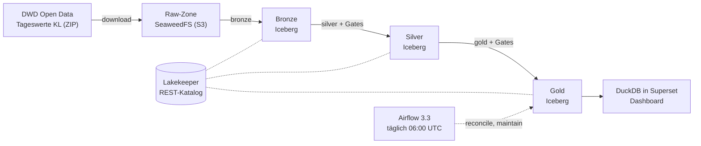

# Climate Lakehouse – Deutschlands Klima seit 1950

[](https://github.com/riodeb21195/climate-lakehouse/actions/workflows/ci.yml)
[](https://github.com/riodeb21195/climate-lakehouse/actions/workflows/cd.yml)

**Leitfrage:** Wie haben sich Hitzetage, Frosttage, Starkregentage, Sonnenstunden und
Mitteltemperatur in Deutschland seit 1950 verändert, je Bundesland und Jahrzehnt, verglichen mit
der Referenzperiode 1961–1990?



## Ergebnis (50 Stationen, alle 16 Bundesländer, Stand 2026-10-29)


Mittel der 16 Bundesländer je Dekade, Abweichung zum Stationsmittel 1961–1990
(`gold.state_decade`):

| Dekade | Mitteltemperatur | Hitzetage (≥ 30 °C) | Frosttage (< 0 °C) | Starkregentage (≥ 20 mm) | Sonnenstunden |
|---|---|---|---|---|---|
| 1960er | −0,23 °C | −0,4 | +5,1 | +0,33 | +3 h |
| 1990er | +0,67 °C | +2,4 | −8,8 | +0,51 | +81 h |
| 2010er | +1,26 °C | +6,6 | −9,6 | −0,04 | +134 h |
| 2020er (2020–2025) | +2,01 °C | +7,2 | −21,6 | +0,56 | +255 h |

Die 2020er sind rund 2 °C wärmer als 1961–1990, mit gut 7 Hitzetagen mehr und gut 20 Frosttagen
weniger pro Station und Jahr. Bei Starkregen zeigt die Stichprobe keinen klaren Trend.

### Kennzahlen der Pipeline
Lauf von null am 2026-10-29 (leere Volumes, frische `.env`) auf einem MacBook von 2019
(Intel i5-8210Y, 2 Kerne, 8 GB RAM, Docker-VM 4,8 GiB), 50 Stationen:

| Schritt | Dauer | Ergebnis |
|---|---|---|
| `make up` (Image aus Cache, alle Dienste healthy) | 2 min 3 s | Airflow startet den ersten Lauf |
| download | 35 s | 101 Dateien, 35 MB |
| bronze | 12 min 24 s | 1.500.719 Zeilen aus 100 Archiven |
| silver | 3 min 6 s | 1.332.799 gültig, 9 abgelehnt (0,0007 %) |
| gold | 1 min 28 s | 3.678 Stationsjahre, 128 Land-Dekaden |
| reconcile | 1 min 2 s | 3 von 3 Abgleichen gleich |
| maintain | 1 min 12 s | Bronze 4 → 2 Dateien, Ablehnungen 6 → 1 Datei |
| Wiederholung bronze / silver / gold (`make …`) | 62 s / 52 s / 53 s, fast nur Start von Container und Spark | 0 Archive geladen (101 übersprungen), 0 Stationen, 0 Dekaden neu |

Der erste Bronze-Versuch wurde dabei vom Speicherlimit beendet; die Korrektur steht in
ADR 0005. Abfragezeiten mit und ohne Partitionierung: ADR 0006.

## Quickstart

Voraussetzungen: Docker (VM mit ~4,8 GiB RAM, ~15 GB freie Platte), [uv](https://docs.astral.sh/uv/).

```bash
make install     # .venv, pre-commit-Hooks
make up          # Image bauen, alle Dienste starten; legt .env aus .env.example an
                 # Airflow (http://localhost:8080) startet den ersten Lauf sofort
make dashboard   # Superset auf http://localhost:8088 (admin / SUPERSET_ADMIN_PASSWORD)
```

`STATION_LIMIT` in `.env` wählt die Stichprobe (Standard 50, reihum je Bundesland; `0` = alle).
`make help` listet alle Befehle. Die Diagramme legt man einmal in Superset an: Datenbank
`duckdb:///:memory:`, je eine Abfrage aus [`dashboard/`](dashboard/) als Dataset.

## Ablauf

Der DAG `climate_pipeline` läuft täglich in dieser Reihenfolge, ein Lauf gleichzeitig:

1. **download**: Verzeichnislisten des DWD lesen, nur neue oder geänderte Dateien laden
   (Name, Zeitstempel und Größe gegen die S3-Metadaten). Jede Datei wird vor dem Speichern
   geprüft (ZIP lesbar, richtige Station, erwartete Spalten). Timeout, Rate Limit,
   Retry mit exponentiellem Backoff nur bei Timeouts, 429 und 5xx.
2. **bronze**: jede neue Dateiversion (Key + SHA-256) parsen und per `MERGE` in Batches nach
   `bronze.dwd_daily_kl`; Werte wie geliefert.
3. **silver**: nur Stationen mit neuen Bronze-Zeilen neu berechnen: `historical` vor `recent`,
   `-999` → `NULL`, Zeilenregeln (physikalische Grenzen), Gates je Lauf.
4. **gold**: Kennzahlen je Station und Jahr nur für geänderte Dekaden, Landesmittel je Dekade
   mit Abweichung zu 1961–1990.
5. **reconcile**: Raw → Bronze → Silver → Gold zählen zusammen.
6. **maintain**: Dateien kompaktieren, Snapshots älter als 7 Tage verwerfen.

Jeder Job schreibt einen Eintrag nach `ops.pipeline_runs` und seine Prüfungen nach
`ops.quality_results`, auch wenn er scheitert, und alarmiert dann (Log, optional Slack).
`make run` löst den DAG aus, `make backfill` mit `full_refresh` (Silver und Gold neu aus Bronze).

## Datenmodell

| Tabelle | Inhalt | Schlüssel | Schreibweise |
|---|---|---|---|
| Raw `raw/dwd/daily_kl/…` | ZIP-Archive und Stationsliste 1:1, Quellstand als S3-Metadaten | Objekt-Key | nur neue Versionen |
| `bronze.dwd_daily_kl` | jede Quellzeile, Werte wie geliefert, mit Herkunft | Quellart, Station, Tag | MERGE je Dateibatch |
| `bronze.dwd_stations` | Stationsliste mit Koordinaten und Bundesland | Station | ersetzt bei neuer Version |
| `bronze.dwd_files` | geladene Dateiversionen | Key, SHA-256 | Append |
| `silver.daily_observations` | eine geprüfte Zeile pro Station und Tag ab `START_YEAR` | Station, Tag | MERGE je geänderter Station |
| `silver.daily_observations_rejected` | Zeilen mit verletzten Regeln (`failed_rules`) | Station, Tag | MERGE je geänderter Station |
| `silver.stations` | Stammdaten | Station | ersetzt |
| `gold.station_year` | Hitze-, Frost-, Starkregentage, Tropennächte, Sonnenstunden, Mitteltemperatur | Station, Jahr | Überschreiben je Dekade |
| `gold.state_decade` | Mittel und Abweichung zu 1961–1990 je Bundesland und Dekade | Land, Dekade | ersetzt |
| `ops.pipeline_runs` | Lauf, Job, Status, Dauer, Zeilen, Details, Fehler | Lauf-ID | Append |
| `ops.quality_results` | Ergebnis jedes Gates und Abgleichs | Lauf-ID, Prüfung | Append |

Zeitstempel sind UTC (`spark.sql.session.timeZone`), Messdaten sind Kalendertage des DWD.
Eine Kennzahl ist `NULL`, wenn ein Jahr weniger als 330 Tage mit dem nötigen Wert hat.

## What happens when …

| Fall | Verhalten | Test |
|---|---|---|
| der Download abbricht | Nächster Lauf lädt nur, was fehlt; nichts doppelt | `test_second_run_transfers_nothing`, `test_download_is_idempotent_and_keeps_source_metadata` |
| der DWD eine HTML-Fehlerseite statt ZIP liefert | Datei wird nicht gespeichert, Exit-Code 1, Alarm | `test_invalid_archive_is_not_stored`, `test_main_returns_nonzero_when_files_fail` |
| der DWD einen Wert korrigiert | Nur die geänderte Zeile wird in Bronze, Silver und Gold (eine Dekade) neu geschrieben | `test_changed_file_updates_only_changed_rows`, `test_recomputes_only_changed_station`, `test_gold_rewrites_only_the_changed_decade` |
| eine ältere Dateiversion später ankommt | überschreibt den neueren Stand nicht | `test_older_file_version_never_overwrites_newer` |
| ein Lauf doppelt ausgeführt wird | liest und schreibt nichts, kein neuer Snapshot | `test_loads_all_files_once`, `test_repeated_run_is_a_no_op`, `test_gold_counts_every_silver_day_and_repeats_as_no_op` |
| ein Wert unplausibel ist (45 h Sonne) | Zeile geht mit Regelnamen in die Ablehnungstabelle | `test_implausible_row_moves_to_rejected_table` |
| zu viele Zeilen durchfallen | Gate stoppt Silver, nichts geschrieben, Gold unverändert, Alarm | `test_failed_gate_writes_nothing_and_keeps_watermark`, `test_failed_gate_is_recorded_and_alerted` |
| eine Raw-Datei nicht in Bronze ankommt | `reconcile` schlägt fehl und alarmiert | `test_reconciliation_detects_raw_files_missing_from_bronze` |
| ein falscher Stand geschrieben wurde | `make rollback` setzt die Tabelle per Time Travel zurück | `test_rollback_restores_the_table_before_a_bad_write` |
| eine neue Kennzahl dazukommt | Spalte wird ohne Neuschreiben ergänzt, alte Zeilen `NULL` bis `gold-full` | `test_new_gold_column_is_added_to_an_existing_table` |
| viele kleine Dateien entstehen | `maintain` kompaktiert, Zeilen bleiben gleich | `test_compaction_merges_small_files_without_changing_rows` |
| Slack nicht erreichbar ist | Alarm steht im Log, der Job meldet trotzdem seinen Fehler | `test_alert_failure_is_logged_not_raised` |

## Design-Entscheidungen

- [ADR 0001: SeaweedFS statt MinIO](docs/adr/0001-seaweedfs-statt-minio.md) (MinIO ist archiviert)
- [ADR 0002: Lakekeeper als Iceberg-REST-Katalog](docs/adr/0002-lakekeeper-rest-katalog.md) (Spark schreibt, DuckDB liest)
- [ADR 0003: Inkrementelles Bronze und Silver mit Iceberg-MERGE](docs/adr/0003-inkrementelles-bronze-silver.md), eigene Quality Gates
- [ADR 0004: Gold-Kennzahlen, Referenzperiode und Überschreiben je Dekade](docs/adr/0004-gold-kennzahlen-und-referenzperiode.md)
- [ADR 0005: Airflow mit LocalExecutor, Spark-Jobs im selben Image](docs/adr/0005-airflow-mit-spark-im-scheduler.md)
- [ADR 0006: Partitionierung, Sortierung und Tabellenwartung](docs/adr/0006-partitionierung-sortierung-wartung.md) (mit Benchmark)

Betrieb, Fehlerbehebung und Rollback: [Runbook](docs/runbook.md).

## Speicherbudget

Ausgelegt auf eine Docker-VM mit ~4,8 GiB; jedes Limit steht in `docker-compose.yml`.

| Dienst | Limit | gemessene Spitze (2026-10-29) |
|---|---|---|
| Postgres (Airflow- und Lakekeeper-DB) | 256 MiB | 103 MiB |
| SeaweedFS (Upload-Puffer auf 64 MB begrenzt) | 512 MiB | 380 MiB |
| Lakekeeper | 128 MiB | 84 MiB |
| Airflow API-Server (UI, Execution API) | 640 MiB | 301 MiB |
| Airflow DAG-Processor | 384 MiB | 284 MiB |
| Airflow Scheduler inkl. Spark-Driver (1,5 GiB Heap) | 2,5 GiB | am Limit (Page Cache zählt mit) |
| Superset (Profil `dashboard`, nur bei Bedarf) | 1 GiB | 435 MiB im Leerlauf |

## Entwicklung

```bash
make lint        # ruff + mypy (strict)
make test        # Unit- und Integrationstests mit Coverage (braucht Docker und Java 17+)
make benchmark   # Abfragezeiten Silver vs. unpartitionierte Kopie
```

Einzelne Jobs ohne Airflow: `make download | bronze | silver | gold | reconcile | compact`,
Neuaufbau mit `make silver-full` / `make gold-full`. Die Unit-Tests nutzen echte, gekürzte
DWD-Dateien (`tests/fixtures/`) und lokales Spark mit Iceberg-Katalog im Temp-Verzeichnis. Die
Integrationstests starten einen eigenen Compose-Stack (`climate-lakehouse-it`, zufällige Ports),
führen die Jobs im Pipeline-Image aus und prüfen dort Import und Aufbau des DAGs. Nach grüner CI
auf `main` pusht die CD das Image nach `ghcr.io/riodeb21195/climate-lakehouse`.

## Bewusst weggelassen

| Weggelassen | Grund |
|---|---|
| Stundenwerte | Alle Kennzahlen der Leitfrage lassen sich aus Tageswerten berechnen. |
| OpenLineage/Marquez | Drei Dienste für ~1 GB RAM; die Abfolge steht im DAG, die Herkunft je Zeile in Bronze. |
| Spark History Server | Dauer und Zeilen je Job stehen in `ops.pipeline_runs`. |
| Great Expectations / Soda | Acht Regeln und drei Gates sind in PySpark wenige Zeilen und normal testbar (ADR 0003). |
| Benchmark in der CI | Geteilte Runner schwanken zu stark für einen Schwellenwert; gemessen wird lokal. |
| Dashboard als Code | Die Abfragen liegen in `dashboard/`, die Diagramme entstehen in der Superset-Oberfläche. |
| Spark-Cluster, Celery, Kubernetes | Ein Rechner, ein Job zur Zeit (ADR 0005). |
| Historie der Stationsorte | Die Leitfrage braucht nur das Bundesland, und das wechselt eine Station nicht. |

## Grenzen

- **Stichprobe:** 50 von 236 geeigneten Stationen (Daten seit 1961, aktiv), bis zu vier je
  Land. Starkregen ist lokal und bräuchte deutlich mehr Stationen.
- **Ortswechsel** einer Station (Höhe, Lage) werden nicht korrigiert; die Abweichung je Station
  gegen ihr eigenes Referenzmittel dämpft den Effekt nur.
- **Das laufende Jahr** hat keine Kennzahlen (weniger als 330 Tage).
- **Harte Abbrüche** (OOM-Kill, Exit -9) erreichen die Jobs nicht mehr: Sie stehen in Airflow,
  aber ohne Eintrag in `ops.pipeline_runs` und ohne Alarm des Jobs.
- **Lokal gedacht:** Airflow-UI ohne Login, Passwörter aus `.env`, kein TLS.
- **Lakekeeper ist 0.x** und gepinnt (ADR 0002).
